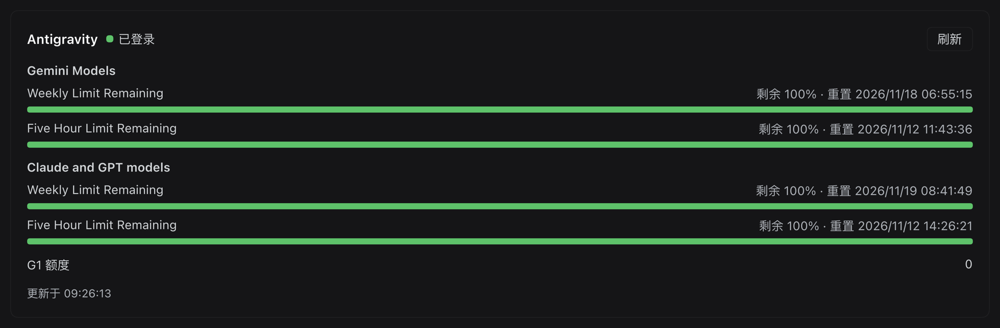
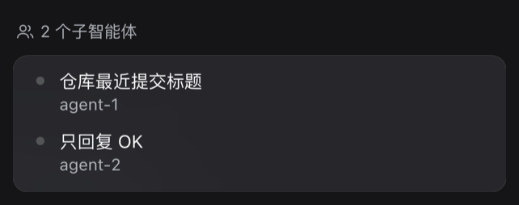

# dsh-antigravity

<!-- Bump the first badge with the @deepseek-ai/dsh-subagent peer range. -->
[](https://github.com/deepseek-ai/deepseek-harness/releases/tag/dsh-v0.2.2-rc.1)
[](https://github.com/Preference-cmd/dsh-antigravity/actions/workflows/ci.yml)
[](./LICENSE)

<!-- 最近一次验证的 DeepSeek Harness 版本。 -->
最近一次验证：DeepSeek Harness 0.2.2-rc.1，`agy` 1.5.5。

模型通过 `subagent_antigravity` 工具把任务委派给本机的 Google Antigravity（`agy`）。子智能体在自己的进程里跑完整一轮，只把最终答案交回父会话，工具调用过程不进入父会话上下文；它有独立的模型、工具与配额，与父会话只共享工作目录。





## 安装

前置：本机装好 `agy` 并完成 Google 登录（`agy models` 能列出模型即可）。

```sh
dsh plugin --profile web add github:Preference-cmd/dsh-antigravity
```

装完重启该 profile。插件自带 provider，不依赖 `@deepseek-ai/dsh-subagent-acp`：每次委派只 spawn 一个 `agy` 打印模式子进程（`--output-format stream-json`）。

## 配置

在 profile 的 `cordis.patch.yml` 里按 id 覆盖：

```yaml
- id: subagent-antigravity
  config:
    model: claude-opus-4-6-thinking
    effort: high
```

| 字段 | 默认 | 说明 |
|---|---|---|
| `command` | `$AGY_BIN` 或 `~/.local/bin/agy` | `agy` 可执行文件 |
| `model` | 账号默认 | `--model`，固定给每次委派的模型 id，用 `agy models` 查 |
| `effort` | 模型默认 | `--effort`：`low`、`medium`、`high`、`xhigh`、`max` |
| `mode` | `agy` 默认 | `--mode`：`accept-edits`、`auto`、`plan` |
| `args` | `[]` | 追加在上述 flag 之后的其它 `agy` flag，如 `["--sandbox"]` |
| `env` | `{}` | 叠加在已清理凭据的父环境之上的显式子环境 |
| `providerName` | `antigravity` | 在 `ctx.subagents` 上注册的名字 |
| `disposeGraceMs` | `3000` | 回收子进程时 SIGTERM 到 SIGKILL 的间隔 |
| `refreshMs` | `60000` | 状态卡在宿主的缓存时长；`?refresh=1` 强制重取 |
| `settingsFile` | `~/.dsh/storages/dsh-antigravity.json` | 面板保存的模型选择存放处 |

`model`、`effort`、`mode` 是 CLI flag，不是会话内协商：`agy` 在启动时校验组合，不支持的组合会让本次委派当场失败并回传原文（例如 `--effort is not supported for model …`），不会带着默认值静默跑完。

## 插件详情页

页面底部有两块，都写在本机、跨会话生效：

- **账号与额度**：登录状态、每个模型族的每周与 5 小时额度、G1 credits。数据来自零 token 的斜杠命令（`agy models`、`/usage`、`/credits`），宿主缓存 60 秒；未登录时直接提示去终端登录，不会拿一次模型调用去探测。
- **模型**：列出 `agy models` 的结果，勾选允许委派使用的模型，再单选一个默认模型。一个都不勾表示全部可用；默认模型只在配置没有固定 `model` 时生效，配置里写死的 `model` 优先。改动写进宿主文档，下一次委派就生效，不用重启。

文案与时间跟随 Harness 的语言设置。

## 已知限制

1. **打印模式不做权限协商**：子进程以 `always-proceed` 运行，文件与命令操作直接执行，harness 拿不到可以拒绝的请求。收窄用 `args: ["--sandbox"]`，或改 Antigravity 自己的 `~/.gemini/antigravity-cli/settings.json`。
2. **只接受纯文本 prompt**，图片/文件块直接报错；prompt 上限 128 KiB，因为打印模式把它放在 argv 上。
3. **单轮、不续接**，每次委派都是独立的一轮，没有多轮会话。
4. **未登录不预检**，委派在子进程里失败并回传 `agy` 的原文诊断。
5. **上游重试告警会进入正文**：Google 端抖动时 `⚠ API error (attempt 1)…` 会以 assistant 文本到达，可能被当成答案。
6. **每次委派新建 `agy` 进程**（冷启动秒级），并在 `~/.gemini/antigravity-cli/conversations` 留下记录；该目录不可写时工具调用会在子智能体内部反复重试。

## 开发

```sh
pnpm install && pnpm run typecheck && pnpm run build
node scripts/verify-build-output.mjs   # lib/ 与源码一致
node scripts/verify-route-cache.mjs    # 状态路由的缓存与强制重取
node scripts/verify-print-runner.mjs   # flag 传递、流折叠、失败与取消
node scripts/verify-model-settings.mjs # 模型列表解析、选择校验、默认模型生效
```

`lib/` 是提交进仓库的构建产物：`dsh plugin add github:…` 直接消费它，不会在安装时构建。CI 因此在每次 push 上跑 typecheck、build，并用 `verify-build-output` 拒绝「改了源码却没重新构建」的提交。

## 许可

MIT — 见 [LICENSE](./LICENSE)。
